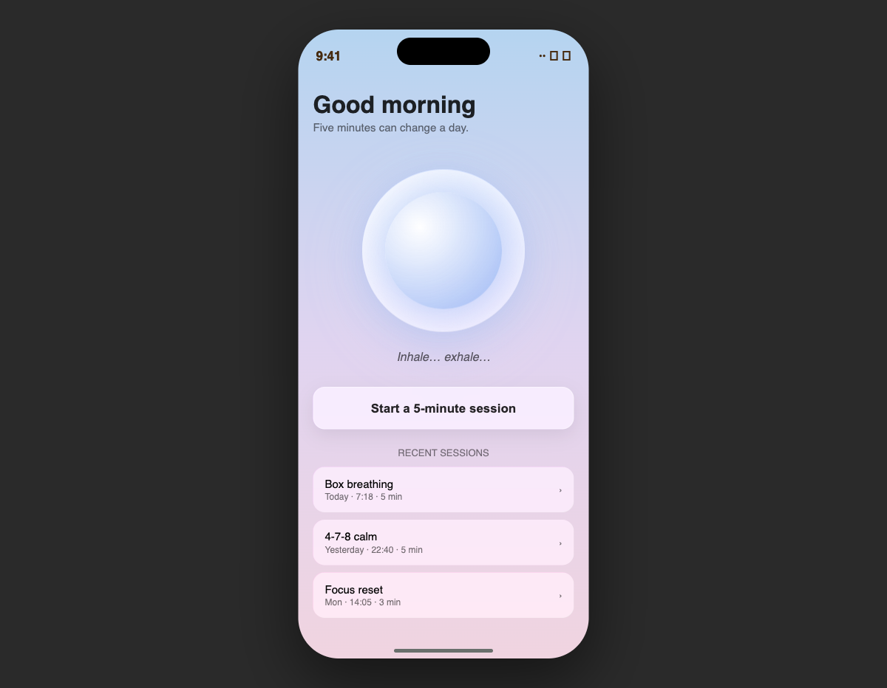

# Breathe — Liquid Native DNA

5 dakikalık nefes egzersizi. Sakin, yumuşak, cam-üstü-cam. Odaklanmak için.

**DNA:** `liquid-native` v1.1.0
**Stack:** SwiftUI + SwiftData + iOS 26 `.glassEffect()`
**iOS hedefi:** 17.0+ (26'da görsel zenginleşir)
**Xcode:** 26+ gerekli (iOS 26 SDK için)

## Ekran (prototipten)



_Bu app'in runtime ekran görüntüsü yok — çünkü `.glassEffect()` iOS 26+ gerektiriyor, Xcode 26 public sürümü henüz çıkmadı. Kod tamam, Xcode 26'da açıldığında çalışacak._

## Neden Xcode 26 gerekli?

`TodayView.swift` ve `SessionView.swift` birkaç yerde:

```swift
if #available(iOS 26.0, *) {
    RoundedRectangle(cornerRadius: 16).glassEffect()
} else {
    RoundedRectangle(cornerRadius: 16).fill(.ultraThinMaterial)
}
```

`.glassEffect()` API'si Xcode 26 SDK'da tanımlı. Xcode 16.2 derleyicisi "cannot find 'glassEffect' in scope" hatası verir. Derlemek için:

- Xcode 26 beta/public ile aç
- Veya her `.glassEffect()` çağrısını `.fill(.ultraThinMaterial)` ile değiştir (fidelity düşer)

## Çalıştır (Xcode 26 ile)

```bash
brew install xcodegen
xcodegen generate
open Breathe.xcodeproj
# ▶ Run (iOS 26 simulator tercihen)
```

## Ne var?

- `TodayView` — "Good morning" selamlama + nefes orb + start button + geçmiş seanslar
- `SessionView` — `fullScreenCover` ile tam ekran odak modu
- `BreathOrb` — `.phaseAnimator` ile 4sn ease-in-out scale 0.85↔1.0
- `SessionLog` — SwiftData ile seans kaydı
- Box breath pattern (4-4-4-4)

## DNA karakteri (Liquid Native)

- **Renk:** pastel gradient (sky → sunset) — `LinearGradient` arka plan
- **Glass:** `.glassEffect()` button, card, orb arka planlarında
- **Motion:** `.phaseAnimator` sürekli döngü, `.spring(response: 0.7, dampingFraction: 0.8)` button scale
- **Tipografi:** `.system(size:, weight: .semibold)` büyük, hava veren satır yüksekliği
- **Shadow:** `Color.blue.opacity(0.3)` yumuşak, 30pt blur

Tüm kararlar `.design/DESIGN_DNA.md` içinde.

## `liquid-ios` ile ilişki

Plugin'in [`/ios-design:init`](https://github.com/coltrosetech/liquid-ios) komutu ile başlatıldı. Liquid Native seçildi çünkü app'in karakteri "iOS 26 ile maksimum uyum + sakin meditasyon dili" idi.

Plugin motion-fidelity kuralları gereği her `.glassEffect()` kullanımı HTML prototip yorumu ile eşleşir:

```html
<!-- swiftui: .glassEffect() | fallback iOS<26: .background(.ultraThinMaterial) -->
```

Bu yüzden fallback her zaman kod içinde mevcut — kod iOS 17'de de çalışır, sadece görsel farkeder.
