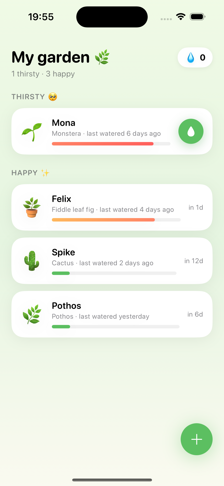
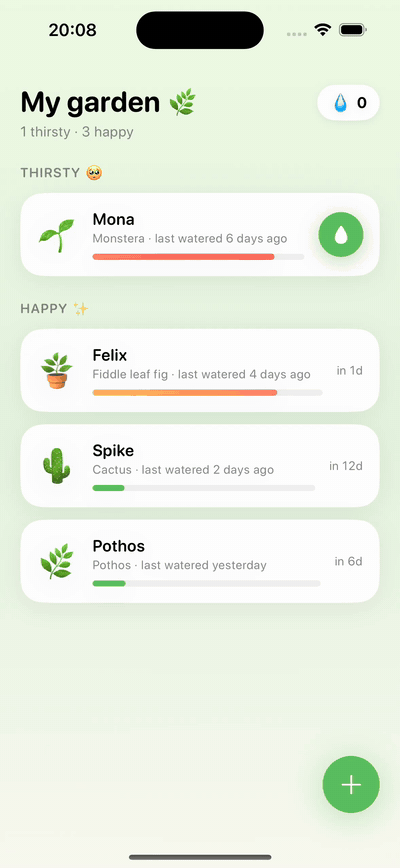
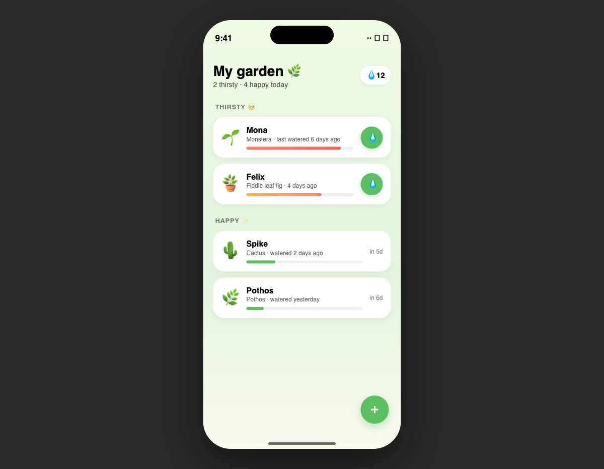

# Sprout — Playful Character DNA

Bitki bakım takipçisi. Emoji karakterler, yumuşak spring animasyonlar, SwiftData kalıcılığı + Charts grafikleri. Eğlenceli ama özenli.

**DNA:** `playful-character` v1.0.0
**Stack:** SwiftUI + SwiftData + Swift Charts
**iOS hedefi:** 17.0+
**Xcode:** 16+

## Ekran

**Runtime — iPhone 16 / iOS 18.3 Simulator:**



**Motion — sulama dokunuşu:**



**Prototipten — Playful Character DNA:**



## Çalıştır

```bash
brew install xcodegen
xcodegen generate
open Sprout.xcodeproj
# ▶ Run (iPhone 16 / iOS 18+ simulator)
```

DEBUG modunda 4 bitki (Mona, Felix, Spike, Pothos) farklı sulama aralıklarıyla otomatik yüklenir.

## Ne var?

- `GardenView` — bitki listesi, her kart thirst level'a göre renklendirilir
- `PlantDetailView` — bitki detayı + sulama geçmişi Swift Charts grafiği
- `AddPlantSheet` — emoji picker grid ile bitki ekleme formu
- `Garden` — `@Observable @MainActor` SwiftData servisi
- `Plant.thirstLevel` — `lastWateredAt` ve `wateringIntervalDays` üzerinden hesaplanan 0.0–1.0 değer

## DNA karakteri (Playful Character)

- **Renk:** canlı yeşil + turuncu accent, neredeyse primer renkler
- **Typography:** `.system(size:, weight: .rounded)` — yuvarlatılmış, arkadaşça
- **Motion:** `.spring(response: 0.4, dampingFraction: 0.6)` — hafif overshoot, playful
- **Emoji:** bitki tanımlayıcı olarak kullanılır (🌱🪴🌵🌿)
- **Corner radius:** 16pt, kartlar arası yumuşak spacing

Tüm kararlar `.design/DESIGN_DNA.md` içinde.

## `liquid-ios` ile ilişki

Bu uygulama plugin'in ilk uçtan-uca doğrulama vakası oldu. Xcode ile gerçekten derlenip Simulator'da çalıştırılıp ekran görüntüsü alınabilen ilk SwiftUI çıktısı.

İlk derleme sırasında `error: extra argument 'damping' in call` hatası alındı — DNA token adı `damping` olarak dokümante edilmişti ama SwiftUI `dampingFraction:` bekliyor. Bu bulgu plugin'in [`references/motion-fidelity-rules.md`](https://github.com/coltrosetech/liquid-ios/blob/main/references/motion-fidelity-rules.md) dosyasına "Critical gotcha" olarak eklendi. Sonraki plugin sürümleri bu eşleşmeyi otomatik yapar.
