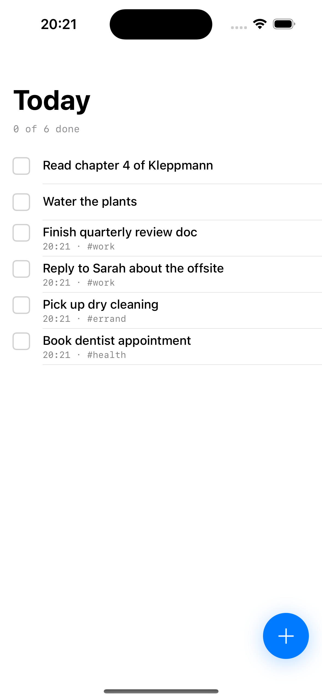

# Todo — Editorial Crisp DNA

Günlük görev listesi. Minimal, sade, ajanda-benzeri. _Aklımdaki şeyi yazacağım, işim bitsin._

**DNA:** `editorial-crisp` v1.1.0
**Stack:** SwiftUI + SwiftData + Swift 6.0 strict concurrency
**iOS hedefi:** 17.0+
**Xcode:** 16+

## Ekran



_iPhone 16 / iOS 18.3 Simulator, DEBUG seed verisiyle._

## Çalıştır

```bash
brew install xcodegen  # tek seferlik
xcodegen generate
open TodoApp.xcodeproj
# ▶ Run (iPhone 16 / iOS 18+ simulator)
```

DEBUG modunda 6 örnek görev otomatik yüklenir (iş, ev, sağlık, öğrenme etiketleriyle).

Komut satırından da build:

```bash
xcodegen generate
xcodebuild -project TodoApp.xcodeproj -scheme TodoApp \
  -destination "platform=iOS Simulator,name=iPhone 16" \
  -configuration Debug CODE_SIGNING_ALLOWED=NO build
```

## Ne var?

- `TodayView` — günün görev listesi, tamamlananları listenin sonuna atar
- `AddTaskSheet` — sheet form ile hızlı görev ekleme (tag + due date)
- `TodoListService` — `@Observable @MainActor` SwiftData adaptörü
- Haptic feedback checkbox toggle'ında

## DNA karakteri (Editorial Crisp)

- **Tipografi:** `.system(size:, weight:)` — başlıklar bold 32pt, meta 12pt secondary
- **Renk:** neredeyse tamamen nötr, tek accent `.blue` (FAB + checkbox done state)
- **Motion:** `.spring(response: 0.45, dampingFraction: 0.85)` — kısa, etkili
- **Divider:** 1pt `.secondary.opacity(0.2)` satır arası
- **Form hiçbir yerde placeholder gradient yok — Apple'ın Notes uygulamasına yakın dil**

Tüm kararlar `.design/DESIGN_DNA.md` içinde.

## `liquid-ios` ile ilişki

Bu uygulama plugin'in [`/ios-design:init`](https://github.com/coltrosetech/liquid-ios) komutu ile başlatıldı. Plugin önce 3 HTML prototip üretti (Editorial Crisp, Liquid Native, Playful Character), Editorial Crisp seçildi, sonra SwiftUI üretimi DNA'ya bağlı kaldı.

Plugin'i kendi projende kullanmak istersen ana repo'ya bak.
